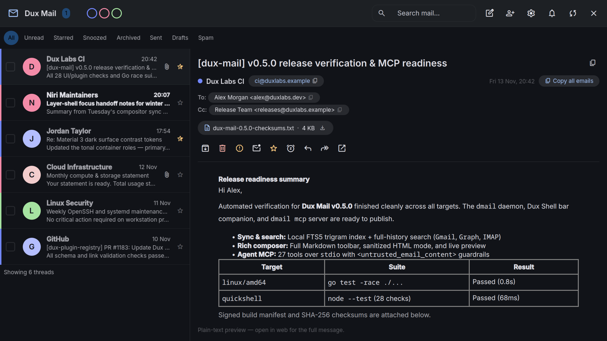

# 📬 Dux Mail

> **Triage your inbox, preserve your focus — for humans and AI agents alike.**  
> A lightning-fast, keyboard-driven mail triage controller for Linux: unified multi-account inbox, local-first SQLite cache, distraction-free Markdown distiller, rich Markdown & HTML composition, and a built-in **Model Context Protocol (`dmail mcp`)** server. Ships as a **standalone desktop app** (`dmail` Go daemon + Quickshell UI) **and** an optional **Dux Shell / DankMaterialShell** bar plugin — powered by the same `dmail` daemon.

<p align="center">
  
</p>

---

## 🗂️ Three surfaces, one `dmail` daemon

`dux-mail` (formerly `dankmail`) ships from this single repository:

| Surface | What it is | Requires |
|---|---|---|
| **Dux Mail** (desktop app) | Standalone mail-triage desktop app: `dmail` daemon, CLI (`dmail list`, `dmail send`, …), and Quickshell UI. Works on any Wayland compositor or headlessly over SSH. | Go, Quickshell (UI optional) |
| **Dux Mail Unread** (bar plugin) | Optional Dux Shell / DankMaterialShell bar widget (unread capsules, filterable account dots, Inbox/Starred/Drafts triage popout) connected to `dmail`. | Dux Shell ≥ 2.0 + `dux-mail` |
| **`dmail mcp`** (MCP server) | Native JSON-RPC 2.0 `stdio` Model Context Protocol server exposing 27 mail tools to Claude Code, Gemini/Antigravity, Codex, OpenCode, and other local agents without browser automation or OAuth token exposure. | `dmail` binary |

Plugin source lives in [`dms-plugin/`](dms-plugin). On Arch Linux, install `dux-mail` and optionally `dms-shell-plugin-dux-mail` (both transparently replace the former `dankmail` packages and migrate existing `~/.config/dankmail`, `~/.local/share/dankmail`, and keyring credentials automatically).

---

## ⚡ The Philosophy

**Dux Mail** is **not a bloated mail client** — it is a **mail controller**.

Modern email clients distract you with tracking pixels, remote scripts, and heavy webviews. Dux Mail is built to clear your inbox in seconds and get back to work:

*   **Keyboard-driven flow:** Archive, delete, star, snooze, compose, and reply in milliseconds.
*   **Safe incoming reader, rich outgoing mail:** Incoming HTML mail is distilled into clean, tracking-free Markdown; outgoing mail and drafts support **full Markdown** (headings, bold, italic, strikethrough, links, nested lists, blockquotes, inline & fenced code, horizontal dividers, and pipe tables) **and** sanitized custom **HTML** (`multipart/alternative` with automatic `text/plain` fallback).
*   **Local-first speed:** Everything runs over a local SQLite cache with FTS5 trigram search. Operations apply optimistically and sync in the background with exponential backoff.
*   **Headless & agent-ready:** Runs with or without a Wayland display (`dmail daemon` / `dmail mcp`), auto-starting on demand over SSH or inside CLI coding agents.

---

## ✨ Features at a Glance

### 🚀 Local-First Sync & Full-History Search
*   **Official Gmail API, Microsoft Graph API & Generic IMAP/SMTP:** First-class OAuth 2.0 PKCE desktop flows for Google and Outlook/Microsoft 365, plus IMAP/SMTP with STARTTLS/TLS.
*   **Server-Side Full-History Search (`SearchRemote`):** Query local FTS5 cache instantly or search full remote history across **Gmail**, **Microsoft Graph**, and **IMAP** (`dmail mcp` `search_remote` or in-app history search).
*   **Optimistic Operation Queue & Thread Freezing:** Actions apply locally at once; threads with pending operations stay frozen during sync so remote state never clobbers in-flight edits.

### ✍️ Rich Markdown & HTML Drafts and Sending
*   **Three Authoring Modes (`Markdown`, `HTML`, `Plain text`):** Switch seamlessly in `ComposeModal`, inline quick reply, CLI (`dmail send`), or MCP (`save_draft`, `send_email`, `reply_thread`, `forward_thread`).
*   **Full Markdown Toolbar & Live Preview:** Insert headings, bold (`Ctrl+B`), italic (`Ctrl+I`), strikethrough, links (`Ctrl+K`), bulleted/numbered lists, quotes, inline/fenced code blocks, pipe tables, and horizontal dividers, then toggle **Preview** before sending or saving.
*   **Sanitized Custom HTML:** Send enriched HTML layouts (`htmlBody` / `--html` / `--html-file`); dangerous tags (`<script>`, `<iframe>`, `<object>`, `<form>`), inline event handlers (`on*=`), and `javascript:` URLs are stripped automatically while preserving clean styling and generating a `text/plain` fallback part.
*   **Synced Drafts:** Local and Gmail-synced drafts preserve their Markdown/HTML format mode and can be edited or sent in one click from the **Drafts** view.

### 🛡️ Distraction-Free Triage & Safety Net
*   **40-Second Undo Banner:** Destructive triage actions (Archive, Trash, Snooze, Spam) hold a 40-second undo window before flushing.
*   **Silent & Interactive Attachments:** Open or save attachments natively from the UI (`~/.cache/duxmail/attachments/`, `0600`), or fetch attachment metadata and UTF-8 text previews silently from agents via `attachments.fetch`.
*   **Dynamic Material 3 Theme & i18n:** Syncs live with Dux Shell colors and typography (`dms-colors.json`) and ships English (`en`), Spanish (`es`), and Brazilian Portuguese (`pt`) translations.

---

## 🤖 AI Agents & MCP Server (`dmail mcp`)

`dmail mcp` exposes your configured mailboxes over standard `stdio` JSON-RPC 2.0 without opening a browser or exposing OAuth tokens/passwords to the LLM context. If the daemon is not running (for example in a headless SSH session), `dmail mcp` starts it automatically without launching Quickshell.

### Permission Modes

| Flag | Allowed capabilities |
|---|---|
| `--mode full` *(default)* | All 27 tools: read, local & remote search, attachment fetch/save, triage (archive/read/star/snooze/spam/trash), drafts, and direct `send_email` / `reply_thread` / `forward_thread`. |
| `--mode draft` | Read, search, attachments, non-destructive triage, and creating/updating/deleting drafts (blocks direct sending and trashing). |
| `--mode draft-strict` | Read, search, attachments, and creating/updating drafts only (blocks triage mutations, draft deletion, and sending). |
| `--mode readonly` | Read, list, local/remote search, contacts, and attachment inspection only. |

All message bodies, snippets, and text attachment previews returned to agents are wrapped in `<untrusted_email_content>` / `<untrusted_attachment_content>` boundaries to mitigate indirect prompt injection.

### Agent Configuration Examples

**Claude Code (`~/.claude.json` or `claude mcp add`):**
```bash
claude mcp add --scope user dux-mail -- dmail mcp
```

**Gemini CLI / Antigravity (`mcp_config.json` / `settings.json`):**
```json
{
  "mcpServers": {
    "dux-mail": {
      "command": "dmail",
      "args": ["mcp"]
    }
  }
}
```

**Codex (`~/.codex/config.toml`):**
```toml
[mcp_servers.dux-mail]
command = "dmail"
args = ["mcp"]
```

**OpenCode (`~/.config/opencode/opencode.json`):**
```json
{
  "mcp": {
    "dux-mail": {
      "type": "local",
      "command": ["dmail", "mcp"],
      "enabled": true
    }
  }
}
```

---

## 🛠️ CLI & IPC Scripting

`dmail` communicates over `$XDG_RUNTIME_DIR/duxmail.sock` (with a `$XDG_RUNTIME_DIR/dankmail.sock` compatibility symlink):

```bash
# Toggle the triage window from a compositor keybinding (Niri / Hyprland / Sway)
dmail toggle

# Query unread threads as JSON
dmail list --unread --json

# Send a rich Markdown or HTML email from the terminal or scripts
dmail send --to team@example.org --subject "Weekly status" --body-file status.md
dmail send --to client@example.org --subject "Invoice" --html-file invoice.html --attach invoice.pdf

# Trigger a manual sync across all accounts
dmail sync
```

---

## 📦 Installation

### Arch Linux (AUR)

```bash
# Stable release (automatically replaces legacy dankmail)
paru -S dux-mail
systemctl --user enable --now dmail

# Git version
paru -S dux-mail-git
systemctl --user enable --now dmail

# Optional Dux Shell / DankMaterialShell bar companion
paru -S dms-shell-plugin-dux-mail
```

Enable **Dux Mail Unread** in DMS Settings → Plugins and add it to the bar. Existing user copies in `~/.config/DankMaterialShell/plugins/dankmailUnread` take precedence over `/etc/xdg/quickshell/dms-plugins/dankmailUnread`.

### From Source

Requires **Go ≥ 1.25** and (for the desktop UI) [Quickshell](https://quickshell.org):

```bash
git clone https://github.com/arqueon/dux-mail && cd dux-mail
make build
make install PREFIX=~/.local
make install-systemd PREFIX=~/.local
systemctl --user enable --now dmail

# Optional: Dux Shell / DankMaterialShell bar companion
make install-dms-plugin
```

---

## 🔑 Account Setup

Public source and AUR builds intentionally ship **without** pre-embedded Google/Microsoft OAuth client credentials (Google treats `gmail.modify` as a restricted scope with per-project quota and verification rules). Each user sets up their own free Desktop OAuth client **once per machine** using the guided in-app wizard or CLI; Dux Mail saves that reusable client in your system keyring so every additional account connects in one click:

*   **Gmail**: Open Dux Mail → Add account → Gmail → follow the guided 5-minute Google Cloud Desktop OAuth setup (or import an existing `client_secret_*.json` / run `dmail account setup google --client-json client_secret.json` + `dmail account add google`). Requests only `gmail.modify`, `gmail.send`, `contacts.readonly`, and `contacts.other.readonly`—never the unrestricted `mail.google.com` scope. See [docs/gmail-setup.md](docs/gmail-setup.md).
*   **Microsoft / Outlook 365**: Choose Add account → Outlook / Microsoft 365 → paste your public Desktop Application (client) ID once (or `dmail account setup microsoft --client-id <azure-client-uuid>` + `dmail account add microsoft`). Uses Microsoft Graph OAuth 2.0 PKCE (`Mail.ReadWrite`, `Mail.Send`, `User.Read`, `offline_access`) with no stored password or client secret.
*   **Generic IMAP + SMTP**: Fastmail, iCloud, Yahoo, Proton Mail Bridge, or custom IMAP/SMTP servers (`dmail account add imap`), storing credentials in your system keyring.

---

## 📚 Additional Documentation

*   [Architecture & sync invariants](docs/architecture.md)
*   [Gmail OAuth setup guide](docs/gmail-setup.md) & [quota pacing](docs/gmail-sync-limits.md)
*   [Local FTS5 & remote search](docs/search.md)
*   [Dux Shell / DMS bar companion guide](dms-plugin/README.md)

## 📜 License

Distributed under the **GPL-3.0-or-later** license. See [LICENSE](LICENSE) for details.  
UI components incorporate MIT-licensed infrastructure adapted from `dankcalendar` (Avenge Media LLC), preserved in [`quickshell/NOTICE`](quickshell/NOTICE).
